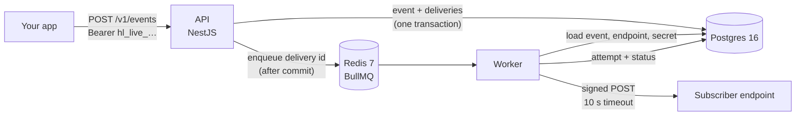

# Hookline

Reliable webhook delivery for your app: signed, queued and recorded attempt by attempt.

[](https://github.com/amosman26/hookline/actions/workflows/ci.yml)
[](LICENSE)

> Early days. v0.1.0 covers API keys, endpoint registration, event ingestion and
> signed delivery through a queue. Retries with backoff, dead-lettering, replay and
> the dashboard are next (see [Roadmap](#roadmap)). A demo will follow the dashboard.

## Why

Sending webhooks looks like one HTTP call. In production it becomes a queue, a retry
policy, signatures your customers can verify, and a record of every attempt so you
can answer "did you send it?". Hookline is that layer as a small service: your app
posts an event once and Hookline owns getting it to every subscribed endpoint.

## Features

Working today (v0.1.0):

- **Project API keys.** Keys look like `hl_live_…`; only a SHA-256 hash is stored.
- **Endpoints and subscriptions.** Register URLs, subscribe each one to event types,
  enable or disable them. Each endpoint gets its own `whsec_…` signing secret.
- **Event ingestion with fan-out.** `POST /v1/events` stores the event and one
  delivery per subscribed endpoint in a single transaction, then queues them.
- **Signed delivery.** HMAC-SHA256 over the id, timestamp and body, sent in
  `Hookline-*` headers. The signing package can sign with more than one secret at
  a time, ready for secret rotation.
- **Attempt history.** Every try is stored with status code, duration, the first
  4 KB of the response body and any network error.
- **Crash-safe queueing.** Postgres is the source of truth; on start-up the worker
  re-queues any delivery still pending, so a Redis outage or a missed enqueue
  doesn't lose work.

On main since v0.1.0: timeouts, network errors, 408, 429 and 5xx are retried with
exponential backoff and full jitter (a random wait up to 5 s, then up to 10 s, 20 s
and so on, longer if `Retry-After` asks, up to 12 attempts); any other 4xx fails the
delivery at once. A delivery still failing after its 12th attempt is dead-lettered:
its status becomes `dead`, kept apart from `failed` (refused by the receiver), and the
worker logs a warning. `POST /v1/deliveries/:id/replay` puts a `failed` or `dead`
delivery back in the queue with a fresh set of 12 attempts; earlier attempts stay in
its history and the event keeps its `Hookline-Id`. `POST /v1/events` takes an
optional `Idempotency-Key` header: a retry with the same key, type and payload gets
the original event back (`202`, `Idempotent-Replayed: true`, deliveries with their
current status) and nothing is stored or queued twice; the same key with a different
event is refused with `422`. Keys are scoped to the project and don't expire yet.

The signing package's `verify()` now rejects timestamps more than five minutes from
the receiver's clock, in either direction.

`POST /v1/events` is rate-limited per API key: 600 requests a minute by default
(`INGEST_RATE_LIMIT`, `INGEST_RATE_WINDOW_SECONDS`; `0` turns it off), counted in Redis
so every API instance shares the budget. Responses carry `RateLimit-Limit`,
`RateLimit-Remaining` and `RateLimit-Reset`; beyond the limit the API answers `429` with
`Retry-After` and stores nothing. It is a fixed window, so up to twice the limit can get
through around a window boundary. If Redis is unreachable the limit is skipped rather
than refusing events.

`POST /v1/endpoints/:id/rotate-secret` issues a new signing secret and returns it once.
The old secret keeps signing alongside it for 24 hours by default (`overlapSeconds`, up
to 7 days; `0` retires it at once), so every delivery in that window carries two `v1=`
signatures and receivers can switch over without dropping a request. Rotating again
during an overlap retires the oldest secret, so at most two are ever active. Endpoint
responses show `previousSecretExpiresAt` while the overlap lasts.

Not yet: the dashboard and OpenAPI docs.

## Architecture



The API never sends webhooks itself. It writes the event and its deliveries, commits,
and only then puts the delivery ids on a BullMQ queue. The worker loads everything
it needs from Postgres, signs the body, sends it and records the attempt.

## Results

No measurements yet. A k6 load test and published numbers are planned for v0.3.0;
until then this section stays empty rather than guessed.

## Engineering decisions

- **Postgres is the source of truth, Redis only carries ids.** A job is just
  `{ deliveryId }`. If Redis loses a job, the delivery is still `pending` in Postgres
  and the start-up sweep queues it again. The job id is the delivery id, so the
  sweep can't create duplicates of a job that is still queued.
- **Enqueue after commit, never inside the transaction.** The worker can't pick up a
  delivery whose event row isn't visible yet, and a failed enqueue never rolls back
  an accepted event: it is logged and left for the sweep.
- **At-least-once, not exactly-once.** A worker can crash after the endpoint answered
  but before the attempt is recorded, so the same event can arrive twice. Receivers
  should de-duplicate on `Hookline-Id`, which stays the same on every attempt.
- **Hashed API keys.** Keys are random and high-entropy, so a plain SHA-256 hash is
  enough (no bcrypt cost on every request) and a database leak doesn't leak keys.
- **The signature covers id and timestamp, not just the body.** That stops a captured
  body being replayed under a new id or time. Comparison is constant-time.
- **The worker is careful with responses it doesn't control.** It doesn't follow
  redirects, caps the stored response body at 4 KB and applies one 10 s timeout to
  the whole exchange, body included.
- **Hand-rolled input validation.** The API surface is small, so plain functions that
  return every problem at once (400 with `message: string[]`) keep the dependencies
  down and the tests direct.

## Quick start

Needs Node 22, pnpm 10 and Docker.

```sh
cp .env.example .env && pnpm install
pnpm infra:up && pnpm db:migrate
pnpm build && pnpm start
```

That starts Postgres and Redis in Docker, applies the migrations, and runs the API on
<http://localhost:3000> with the worker next to it. Without Docker, leave out
`pnpm infra:up` and point `DATABASE_URL` and `REDIS_URL` in `.env` at your own
Postgres 16 and Redis 7.

### Send your first webhook

In a second terminal, mint a project and key (the key is printed once; only its hash
is stored):

```sh
export HOOKLINE_API_KEY=$(pnpm --silent --filter @hookline/api create-key "Acme")
```

Register an endpoint (any URL that accepts a POST; a local server works) and subscribe
it to an event type. The response includes the endpoint's signing secret, shown only
this once:

```sh
curl -s localhost:3000/v1/endpoints \
  -H "Authorization: Bearer $HOOKLINE_API_KEY" -H "Content-Type: application/json" \
  -d '{"url": "http://localhost:4000/webhooks", "eventTypes": ["order.paid"]}'
```

Send an event:

```sh
curl -s localhost:3000/v1/events \
  -H "Authorization: Bearer $HOOKLINE_API_KEY" -H "Content-Type: application/json" \
  -d '{"type": "order.paid", "payload": {"orderId": "ord_123", "amount": 4200}}'
```

The API answers `202` with the event id and one `pending` delivery per subscribed
endpoint; the worker delivers it a moment later.

## API overview

Every route except `/health` needs `Authorization: Bearer <api key>` and only sees the
key's own project. Bodies are JSON; unknown fields are rejected with `400`.

| Method   | Path                              | Purpose                                                            |
| -------- | --------------------------------- | ------------------------------------------------------------------ |
| `GET`    | `/health`                         | Liveness check, no auth                                            |
| `GET`    | `/v1/project`                     | The project the key belongs to                                     |
| `POST`   | `/v1/endpoints`                   | Register an endpoint; returns its secret once                      |
| `GET`    | `/v1/endpoints`                   | List endpoints                                                     |
| `GET`    | `/v1/endpoints/:id`               | Fetch one endpoint                                                 |
| `PATCH`  | `/v1/endpoints/:id`               | Change `url`, `description`, `eventTypes` or `enabled`             |
| `POST`   | `/v1/endpoints/:id/rotate-secret` | Issue a new secret; the old one signs too for `overlapSeconds`     |
| `DELETE` | `/v1/endpoints/:id`               | Remove an endpoint and its deliveries                              |
| `POST`   | `/v1/events`                      | Accept `{ type, payload }` and fan it out (`202 Accepted`)         |
| `POST`   | `/v1/deliveries/:id/replay`       | Queue a `failed` or `dead` delivery again (`202`; `409` otherwise) |

Endpoint URLs must be `http` or `https` without credentials. Event types are 1–100
characters of letters, digits and `._:-`, starting with a letter or digit; an endpoint
takes 1–50 of them, matched exactly (no wildcards yet). `payload` must be a JSON object.

### What your endpoint receives

```http
POST /webhooks HTTP/1.1
Content-Type: application/json
Hookline-Id: b7b0c4e1-cf2b-489e-a180-91c4d604f63e
Hookline-Timestamp: 1795371404
Hookline-Signature: v1=2d6a6ec9…

{"id":"b7b0c4e1-…","type":"order.paid","createdAt":"2026-11-22T18:16:44.180Z","data":{"amount":4200,"orderId":"ord_123"}}
```

Answer with any `2xx` to mark the delivery `succeeded`.

### Verifying the signature

The signature is the hex HMAC-SHA256 of `{Hookline-Id}.{Hookline-Timestamp}.{raw body}`,
keyed with the full endpoint secret (including `whsec_`). During a secret rotation the
header carries two space-separated `v1=` values, one per secret; accept the request if
any matches. To rotate, call `rotate-secret`, deploy the new secret to your receiver
within the overlap, and the old one simply stops being used when it expires.

```ts
import { createHmac, timingSafeEqual } from "node:crypto";

export function isValid(headers: Record<string, string>, rawBody: string, secret: string) {
  // Refuse anything signed more than five minutes from now, either way.
  const age = Math.abs(Date.now() / 1000 - Number(headers["hookline-timestamp"]));
  if (!(age <= 300)) return false;
  const expected = createHmac("sha256", secret)
    .update(`${headers["hookline-id"]}.${headers["hookline-timestamp"]}.${rawBody}`)
    .digest();
  return (headers["hookline-signature"] ?? "")
    .split(" ")
    .filter((part) => part.startsWith("v1="))
    .map((part) => Buffer.from(part.slice(3), "hex"))
    .some((given) => given.length === expected.length && timingSafeEqual(given, expected));
}
```

Verify against the raw body bytes, before any JSON parsing. The timestamp check limits
replays of a captured request to five minutes; every attempt is signed afresh, so a
retry is never refused for its age. `verify()` in `packages/signing` does the same
checks, with the tolerance adjustable.

## Testing

```sh
pnpm lint && pnpm format:check && pnpm typecheck && pnpm test
```

Unit tests run anywhere. Integration and end-to-end tests use real Postgres and Redis
from `DATABASE_URL` and `REDIS_URL` (never mocks of them) and are skipped locally when
those aren't set; CI runs them against `postgres:16` and `redis:7` service containers.
The end-to-end suite posts an event to the API, lets a real worker deliver it to a
local receiver and checks the signature.

## Project structure

```text
apps/
  api/        NestJS REST API: auth, endpoints, events, replay, create-key CLI
  worker/     BullMQ consumer that signs, sends and records attempts
packages/
  db/         Drizzle schema, SQL migrations and migrate CLI
  queue/      Queue name, job shape and Redis connection shared by API and worker
  signing/    Zero-dependency HMAC-SHA256 sign and verify
```

## Roadmap

- **v0.2.0, reliability and security:** retry timeouts, 408, 429 and 5xx with
  exponential backoff and full jitter; dead-letter after 12 attempts; manual replay;
  `Idempotency-Key`; per-key rate limiting; a five-minute timestamp tolerance; secret
  rotation with an overlap window.
- **v0.3.0, dashboard and observability:** a Next.js dashboard for endpoints and
  attempt timelines, OpenTelemetry tracing, Prometheus metrics, partitioned attempt
  storage and measured load-test results.

## Licence

[MIT](LICENSE)
